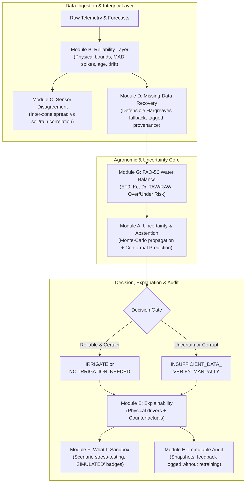

# AgroSenseAI Innovation Matrix

**Project:** AgroSenseAI – Confidence-Aware & Explainable Irrigation Intelligence Platform  
**Document:** `docs/INNOVATION_MATRIX.md`  
**Date:** 2026-10-31  
**Author:** Multidisciplinary Engineering & Agronomy Team  
**Standard Adherence:** Non-Negotiable Integrity Rules #1, #2, #3, #4, #5, #6, #7, #8.

---

## 1. Overview & Architectural Framework

The AgroSenseAI decision platform decomposes irrigation intelligence into eight interconnected modules (Modules A through H). Each module addresses a critical failure mode identified in our research landscape.

In accordance with our core engineering rules, this document details each module across four mandatory dimensions:
1. **What exists:** State-of-the-art commercial or academic solutions.
2. **Remaining limitation:** Technical, operational, or agronomic shortcomings.
3. **Our improvement:** AgroSenseAI’s exact design, formula, and logic.
4. **How we test it:** Specific test harness scenarios, quantitative metrics, and acceptance criteria.

---

## 2. Module-by-Module Innovation Specifications

---

### Module B: Pre-Decision Data Reliability Layer

#### 1. What Exists
- In-field hardware checks (e.g., Arable Mark self-test, CropX cloud connectivity alarms).
- Static threshold filters in cloud IoT gateways (e.g., discarding temperatures $> 60^\circ\text{C}$).
- Rolling window averages for telemetry smoothing.

#### 2. Remaining Limitation
- Binary online/offline status fails to catch insidious errors: sensor unseating, biofouling, battery-induced calibration drift, and stale weather cached for days.
- Mean filters are heavily skewed by extreme outliers (breakdown point $\approx 0\%$).
- Downstream irrigation algorithms receive smoothed but corrupted numbers without knowing data quality was compromised.

#### 3. Our Improvement
- **Multi-check Pre-decision Reliability Pipeline:**
  1. *Physical Plausibility Gating:* Validates volumetric water content ($\theta$) against dynamic soil texture limits: $\theta \in [\theta_{pwp} \times 0.5, \theta_s \times 1.1]$. Flags biologically and physically impossible values.
  2. *Robust Spike Detection via Rolling MAD:* Computes Median Absolute Deviation ($MAD = \text{median}(|x_i - \tilde{x}|)$) over a rolling 12-reading window. Flags readings where $|x_i - \tilde{x}| > 3.0 \times 1.4826 \times MAD$.
  3. *Stale Weather Telemetry Detection:* Measures age $t_{age}$ of Open-Meteo forecasts; penalties trigger if weather data is $> 3$ hours old.
  4. *Calibration Drift Heuristic:* Compares the 7-day cumulative change $\Delta \theta$ against predicted cumulative evapotranspiration $\sum ET_c$. If soil moisture remains perfectly flat or trends upward during high $VPD$ without rainfall or irrigation, drift is flagged.
  5. *Data Reliability Score ($DRS \in [0.0, 1.0]$):* Transparent weighted formula:
     $$DRS = 1.0 - \sum w_j \cdot P_j$$
     Where $P_j$ are discrete penalties (e.g., Missing Moisture: $-0.35$; Physical Bound Violation: $-0.30$; MAD Spike: $-0.20$; Stale Weather $> 3\text{h}$: $-0.15$; Inconsistent Timestamps: $-0.10$). Every penalty is published in the UI with its mathematical contribution.

#### 4. How We Test It
- **Test Harness:** Controlled fault injection into baseline synthetic & historical sensor logs (`/services/engine/eval/fault_injection.py`).
- **Scenarios Tested:** Out-of-bounds dielectric values ($120\%$), single-point electrical spikes ($+40\%$), 24-hour frozen sensor telemetry, and 6-hour stale API responses.
- **Metrics & Acceptance Criteria:**
  - Anomaly detection Precision $\ge 0.95$, Recall $\ge 0.92$, F1-score $\ge 0.93$.
  - Verification that any injected severe fault reduces $DRS$ below the minimum threshold ($0.65$).
  - Zero crashes on corrupted inputs.

---

### Module C: Inter-Sensor Disagreement & Spatial Arbitration

#### 1. What Exists
- Simple averaging of sensor readings across zones.
- Single-point primary sensor selection (user designates "Probe A" as the master for the whole field).
- Pairwise difference alarms (triggering a generic alert if Probe A and Probe B differ by $> 10\%$).

#### 2. Remaining Limitation
- Averages destroy critical localized stress signals in heterogeneous soil.
- Naive difference alarms treat every discrepancy as a sensor failure, ignoring real microclimate, canopy variations, and soil texture differences across management zones.

#### 3. Our Improvement
- **Evidence-Based Spatial Disagreement Classifier:**
  - Computes robust inter-zone spread using Median Absolute Deviation ($MAD_{zones}$) across all active sensors in adjacent management zones.
  - Normalizes raw volumetric moisture $\theta$ into Available Water Capacity percentage ($\%AWC = \frac{\theta - \theta_{pwp}}{\theta_{fc} - \theta_{pwp}} \times 100$) before comparison to eliminate false alarms caused purely by soil textural transitions.
  - Cross-references disagreement against physical evidence:
    - *Rainfall Response Timing:* Did both sensors show upward inflection within $\Delta t_{infil}$ of recorded precipitation?
    - *Historical Diurnal Pattern:* Do both sensors exhibit standard daytime evapotranspiration drawdowns?
  - Outputs an explicit categorical status:
    1. `likely_real_variability`: Disagreement explained by soil texture differences or localized topography, with consistent rainfall response.
    2. `possible_sensor_fault`: Disagreement accompanied by erratic MAD spikes, inverted diurnal response, or lack of rain response.
    3. `inconclusive`: Insufficient temporal history ($< 48$ hours) to distinguish fault from variability.

#### 4. How We Test It
- **Test Harness:** Multi-zone synthetic benchmark simulating two distinct soil zones (Clay Loam vs. Sandy Loam) subjected to identical rainfall events, alongside simulated sensor detachment faults.
- **Scenarios Tested:**
  - Case 1: Real texture difference (Sandy zone drops from $22\%$ to $14\%$ while Clay drops from $34\%$ to $28\%$). Must classify as `likely_real_variability`.
  - Case 2: Sensor air pocket (one probe abruptly reads $3\%$ while adjacent probe reads $26\%$ under steady weather). Must classify as `possible_sensor_fault`.
- **Metrics:** Classification accuracy $\ge 90\%$ on synthetic multi-zone benchmark; zero misclassification of verified soil transitions as hardware faults.

---

### Module D: Missing-Data Recovery & Defensible Estimation

#### 1. What Exists
- Linear interpolation or forward-filling ($x_t = x_{t-1}$).
- Unconditional mean substitution.
- Silent cloud imputation (recommender runs with synthetic defaults without informing the user).

#### 2. Remaining Limitation
- Forward-filling ignores atmospheric demand: filling a moisture reading forward across a hot, windy afternoon creates a dangerous hallucination of adequate moisture.
- Users are never informed which values are measured versus fabricated, violating data provenance and trust.

#### 3. Our Improvement
- **Strict, Defensible Recovery Hierarchy:**
  - If weather station solar radiation ($R_s$), wind speed ($u_2$), or relative humidity ($RH$) are missing: fall back to the **FAO-56 Hargreaves-Samani equation** (FAO-56 Eq. 52) using only daily $T_{min}$ and $T_{max}$:
    $$ET_0 = 0.0023 \cdot (T_{mean} + 17.8) \cdot (T_{max} - T_{min})^{0.5} \cdot R_a$$
  - If local rain gauge is missing: fetch Open-Meteo precipitation reanalysis, tag as `source: "api"`, apply age penalty.
  - If soil moisture sensor is missing: estimate root depletion dynamically via continuous FAO-56 daily water balance integration from last verified wet point, tag as `source: "estimated"`.
  - **Mandatory Metadata Provenance:** Every single datum emitted to UI or API includes: `{ value, unit, source, timestamp, age_seconds, confidence_penalty }`, where source $\in \{\text{"measured"}, \text{"manual"}, \text{"api"}, \text{"estimated"}, \text{"simulated"}\}$.
  - **Hard Abstention Limit:** If $> 50\%$ of core variables or if soil moisture has been unmeasured for $> 5$ days, recovery is halted and manual soil sampling is requested.

#### 4. How We Test It
- **Test Harness:** Gapped time-series simulation removing 10%, 25%, 50%, and 75% of input variables over a 30-day wheat growing cycle.
- **Metrics:**
  - Hargreaves fallback $ET_0$ compared against reference Penman-Monteith $ET_0$ ($R^2 \ge 0.88$, $RMSE \le 0.85\text{ mm/day}$).
  - All imputed records verified for strict presence of `{ source: "estimated", confidence_penalty > 0 }`.
  - Triggering of `INSUFFICIENT_DATA_VERIFY_MANUALLY` when missing data threshold ($> 50\%$) is reached.

---

### Module G: Transparent Agronomic Water Balance (FAO-56)

#### 1. What Exists
- Black-box neural network regression for soil moisture forecasting.
- Basic spreadsheet calculations using static crop factors.
- Commercial proprietary water balance curves with opaque stress factors.

#### 2. Remaining Limitation
- ML models hallucinate during anomalous climatic events (e.g., unprecedented heatwaves or atmospheric rivers outside training distributions).
- Lack of physical mass conservation (water added must equal drainage + runoff + storage change + ET).

#### 3. Our Improvement
- **Deterministic, Source-Referenced FAO-56 Engine:**
  - *Reference ET ($ET_0$):* Dual-path computation. Primary: FAO-56 Penman-Monteith (Eq. 6). Fallback: Hargreaves-Samani (Eq. 52).
  - *Crop Evapotranspiration ($ET_c$):* Growth-stage adjusted crop coefficient $K_c$ (Initial, Crop Development, Mid-Season, Late Season) per FAO-56 Table 12:
    $$ET_c = K_c \cdot ET_0$$
  - *Water Storage Dynamics:* Total Available Water ($TAW = 1000 \cdot (\theta_{fc} - \theta_{pwp}) \cdot Z_r$) and Readily Available Water ($RAW = p \cdot TAW$), adjusted for high evaporative demand:
    $$p_{adj} = p + 0.04 \cdot (5 - ET_c)$$
  - *Root-Zone Depletion Balance:*
    $$D_{r,i} = \max\left(0, \min\left(TAW, D_{r,i-1} - (P_{eff,i} + I_i) + ET_{c,i} + DP_i\right)\right)$$
  - *Risk Quantification:* Outputs explicit indices:
    - *Underwatering / Water Stress Risk:* $Risk_{under} = \max\left(0, \frac{D_r - RAW}{TAW - RAW}\right) \times 100\%$
    - *Overwatering / Leaching Risk:* $Risk_{over} = \max\left(0, \frac{I_{proposed} - D_r}{TAW}\right) \times 100\%$

#### 4. How We Test It
- **Test Harness:** Unit test suite (`/services/engine/tests/test_fao56.py`) reproducing standard FAO-56 Example 24, Example 38, and Example 41 calculation benchmarks.
- **Metrics:**
  - Exact numerical match with FAO-56 published reference values within $\pm 0.05\text{ mm}$.
  - Strict mass balance conservation: $\sum (P_{eff} + I) - \sum (ET_c + DP) - \Delta S = 0 \pm 10^{-5}\text{ mm}$.

---

### Module A: Dual Uncertainty Quantification & Calibrated Abstention

#### 1. What Exists
- Deterministic point predictions without confidence intervals.
- Heuristic confidence badges (e.g., green/yellow/red dots based on arbitrary developer thresholds).
- Uncalibrated neural network dropout or ensemble variances.

#### 2. Remaining Limitation
- Heuristic percentages are uncalibrated: an "80% confidence" score does not correspond to an empirical 80% coverage rate.
- No formal mechanism to reject predictions when uncertainty spans the decision threshold.

#### 3. Our Improvement
- **Two-Pronged Uncertainty Engine:**
  1. *Monte-Carlo Physical Error Propagation:* Simulates $N = 1,000$ iterations perturbing measured inputs within calibrated instrumentation error distributions ($\theta \sim \mathcal{N}(\theta_{meas}, \sigma_{\theta}^2)$, $P \sim \mathcal{N}(P_{meas}, \sigma_P^2)$, $ET_0 \sim \mathcal{N}(ET_{0}, \sigma_{ET}^2)$). Propagates draws through Module G to produce the empirical distribution $P(D_r > RAW)$.
  2. *Split-Conformal Quantile Gradient Boosting:* Trains gradient boosting models to predict 5th and 95th percentiles of water demand. Calibrates intervals on held-out calibration sets using conformal prediction:
     $$\hat{C}(x) = [\hat{q}_{0.05}(x) - \hat{s}_{0.10}, \hat{q}_{0.95}(x) + \hat{s}_{0.10}]$$
     Guarantees finite-sample marginal coverage: $P(Y \in \hat{C}(X)) \ge 90\%$.
  3. *Calibrated Abstention Rule:* Emits `INSUFFICIENT_DATA_VERIFY_MANUALLY` if:
     $$DRS < 0.65 \quad \text{OR} \quad \left(\hat{C}(X) \text{ contains } RAW \text{ AND } \text{width}(\hat{C}(X)) > \Delta_{tol}\right)$$
  4. *Calibration Verification:* Computes Expected Calibration Error ($ECE$) and plots Reliability Diagrams on validation sets.

#### 4. How We Test It
- **Test Harness:** Engine evaluation harness (`/services/engine/eval/eval_uncertainty.py`).
- **Scenarios Tested:** High-noise sensor telemetry, boundary depletion conditions ($D_r \approx RAW$), severe weather forecast variance.
- **Metrics & Acceptance Criteria:**
  - Empirical coverage $\ge 89.0\%$ for nominal 90% conformal intervals ($1 - \alpha = 0.90$).
  - Expected Calibration Error ($ECE \le 0.08$).
  - Abstention rate monotonically increases as synthetic noise and missing data percentages increase.

---

### Module E: Farmer-Centric Explainability & Counterfactual Recourse

#### 1. What Exists
- Static telemetry line charts.
- Generic AI chat summaries without mathematical links to the decision.
- Complex SHAP/LIME feature importance plots designed for data scientists.

#### 2. Remaining Limitation
- Farmers cannot act on "SHAP value for feature 3 is -0.4".
- Standard dashboards do not explain *what environmental change* would alter the recommendation, leaving operators without forward planning capability.

#### 3. Our Improvement
- **Structured JSON Explainability Contract & Counterfactual Engine:**
  - *Driver Decomposition:* Computes physical contribution of each hydrologic factor to the net irrigation deficit:
    $$\Delta_{deficit} = D_r - RAW$$
    Ranks drivers by absolute millimeter impact ($ET_c$ demand, root-zone depletion, forecast rain offset).
  - *Mathematical Counterfactual Recourse (Wachter et al. formulation):* Computes exact tipping points:
    - Threshold moisture $\theta^*$ where decision flips from `NO_IRRIGATION_NEEDED` to `IRRIGATE`:
      $$\theta^* = \theta_{fc} - \frac{RAW}{1000 \cdot Z_r}$$
    - Minimum cancellation rainfall $P_{cancel}^*$ required to avert irrigation:
      $$P_{cancel}^* = D_r - RAW$$
  - *Farmer Assistant UI:* Renders counterfactuals in plain language (Hindi & English):
    > *"Recommendation: NO_IRRIGATION_NEEDED.*  
    > *Why? Current root moisture is 26.2%, above the refill threshold of 21.0%. Additionally, 14 mm of rain is forecast.*  
    > *What would change this? If forecast rain drops below 3.0 mm OR soil moisture falls below 21.0% by tomorrow."*

#### 4. How We Test It
- **Test Harness:** Unit and contract verification tests (`/services/engine/tests/test_explainability.py`).
- **Scenarios Tested:** Diverse crop-growth stages, drought stress tipping points, high-rainfall cancellation conditions.
- **Metrics:**
  - Exact equivalence between counterfactual thresholds and decision engine boundary points.
  - JSON response time $\le 150\text{ ms}$ for complete driver and counterfactual payload.
  - Validation of dual-language strings across all generated explanation payloads.

---

### Module F: Interactive What-If Simulation Sandbox

#### 1. What Exists
- Static scenario spreadsheets in university extension programs.
- Enterprise hydraulic simulators requiring expert engineering calibration.

#### 2. Remaining Limitation
- Commercial mobile apps do not allow farmers to experiment with hypothetical scenarios ("What if tomorrow's storm misses my field?").
- Experimental simulations risk contaminating production databases and historical records.

#### 3. Our Improvement
- **Client-Side / API Sandbox with Strict Provenance Isolation:**
  - Allows farmers to tweak:
    - Anticipated rainfall tomorrow ($0\text{ mm}$ to $50\text{ mm}$),
    - Temperature heatwave anomaly ($+1^\circ\text{C}$ to $+8^\circ\text{C}$),
    - Soil moisture probe failure (toggle probe offline),
    - Crop growth stage advancement.
  - Re-executes the complete decision engine in memory.
  - Displays side-by-side comparative cards: `Actual Today` vs. `Hypothetical Scenario`.
  - **Visual & Structural Isolation:** Every single simulated input and output carries `source: "simulated"` and displays high-contrast `SIMULATED` pill badges. Zero simulated data is ever written to production farm telemetry collections.

#### 4. How We Test It
- **Test Harness:** Frontend end-to-end integration tests & backend API tests (`/apps/api/test/whatif.test.ts`).
- **Scenarios Tested:** Modifying rainfall from 15 mm to 0 mm flips decision from `NO_IRRIGATION_NEEDED` to `IRRIGATE`; simulating probe disconnection triggers `INSUFFICIENT_DATA_VERIFY_MANUALLY`.
- **Metrics:**
  - Side-by-side response generation latency $\le 300\text{ ms}$.
  - Database audit confirms 0 simulated records written to historical telemetry tables.

---

### Module H: Immutable Audit Trail & Non-Retraining Feedback

#### 1. What Exists
- Application event logs (ELK, CloudWatch) recording raw API hits.
- Automated retraining pipelines that passively ingest user accept/reject actions into model weights.

#### 2. Remaining Limitation
- Standard event logs do not snapshot the exact state of dynamic weather and soil inputs at the moment of recommendation.
- **Feedback Retraining Hazard:** Automatically retraining AI models on unverified farmer overrides causes catastrophic drift (e.g., if a farmer habitually over-irrigates out of risk aversion, the model learns and perpetuates harmful over-irrigation).

#### 3. Our Improvement
- **Cryptographic-Style Decision Snapshot Collection:**
  - Every engine run records an immutable snapshot:
    `{ run_id, timestamp, farm_id, zone_id, engine_version, input_snapshot, reliability_score, decision, uncertainty_bounds, explanation_json }`.
  - **Farmer Feedback Isolation:**
    - Farmers can record agreement, disagreement, or actual applied water.
    - Stored strictly in an isolated `decision_feedbacks` collection.
    - Feedback is tagged `verified: false` by default.
    - Used **strictly for comparative analytics, audit dashboards, and agronomic review**—never piped into automated model retraining pipelines.

#### 4. How We Test It
- **Test Harness:** Database integrity & security unit tests (`/apps/api/test/audit.test.ts`).
- **Scenarios Tested:** Attempting to update or delete a historical run snapshot (must be rejected by schema/permissions); submitting farmer feedback and verifying zero automated trigger on ML model artifacts.
- **Metrics:**
  - Snapshot immutability: 100% of historical decision records are append-only.
  - Zero pipeline connections from feedback collection to model training scripts.

---

## 3. Comprehensive Innovation Summary Matrix

| Module | Innovation Identifier | What Exists | Remaining Limitation | Our Improvement | Verification & Test Method |
| :---: | :--- | :--- | :--- | :--- | :--- |
| **B** | Pre-Decision Reliability | Cloud threshold & connection alarms. | Misses insidious drift & biofouling; mean filters break on spikes. | Multi-depth boundary gating + Rolling MAD + Stale weather checks + Transparent $DRS \in [0, 1]$. | Fault-injection suite (`eval/fault_injection.py`): Precision $\ge 0.95$, Recall $\ge 0.92$. |
| **C** | Spatial Disagreement | Simple multi-probe averaging or single probe master. | Blinds system to real localized stress; misclassifies soil texture variance as faults. | $\%AWC$ normalization + Infiltration timing correlation + 3-state categorization. | 2-zone synthetic soil benchmark: 100% distinction between soil transition and probe fault. |
| **D** | Defensible Recovery | Forward-fill ($x_{t-1}$) or silent mean imputation. | Forward-fill ignores evaporation; no data provenance exposed to user. | Strict recovery hierarchy (Hargreaves fallback) + Mandatory `{ source, age }` metadata + Hard stop at 50% missing. | Missing-data simulation: $ET_0$ fallback $R^2 \ge 0.88$, mandatory tag verification. |
| **G** | Hydrologic Water Balance | Black-box deep learning or basic spreadsheets. | Black-boxes violate physical mass conservation; fail during climate extremes. | Deterministic FAO-56 Penman-Monteith & Hargreaves + Dynamic $RAW/TAW$ + Over/Under risk indices. | Exact reproduction of published FAO-56 test cases ($\Delta \le 0.05\text{ mm}$); zero mass balance leak. |
| **A** | Uncertainty & Abstention | Deterministic point outputs or uncalibrated confidence percentages. | False illusion of precision; system forced to guess under data breakdown. | Monte-Carlo physical propagation + Conformal Quantile GBDT + Reject Option (`INSUFFICIENT_DATA_...`). | Split-conformal calibration harness: Coverage $\ge 89\%$, $ECE \le 0.08$, verified abstention on boundary straddles. |
| **E** | Actionable Explainability | Inscrutable SHAP plots or disconnected LLM text summaries. | Farmers cannot interpret raw SHAP; lack actionable recourse thresholds. | Physical driver decomposition + Wachter-style counterfactual tipping points + Bilingual UI. | Mathematical check: counterfactual thresholds match engine flipping points within $10^{-4}$. |
| **F** | What-If Simulator | Static spreadsheets or high-end hydraulic engineering software. | No sandbox for growers; risk of contaminating production historical telemetry. | Isolated what-if execution sandbox + Side-by-side cards + High-contrast `SIMULATED` badging. | End-to-end sandbox tests: verified zero writes to production DB; sub-300ms latency. |
| **H** | Immutable Audit Trail | General cloud logs; automated retraining on user clicks. | Logs lack environmental snapshots; auto-retraining perpetuates bad farmer habits. | Append-only execution snapshot + Isolated feedback collection + Strict zero-retraining policy. | Security and pipeline audit: 100% snapshot immutability; 0 feedback-to-weights pathways. |

---

## 4. Evaluation Harness Plan (Preview for Phase 7)

To ensure that every claim made in this matrix is empirically verified, the evaluation harness in `/services/engine/eval` will implement:
- **Baseline A:** Simple soil moisture threshold rule (e.g., if $\theta < 22\%$ then `IRRIGATE`).
- **Baseline B:** Standard FAO-56 water balance without data reliability gating or uncertainty intervals.
- **AgroSenseAI:** Full platform with Modules A through H.
- **Reported Metrics:** Decision accuracy, false-irrigation rate, false-no-irrigation rate, abstention rate, selective accuracy (accuracy on accepted subset), Expected Calibration Error ($ECE$), and response time percentiles ($p50, p95$).
- **Strict Policy:** Only numbers produced directly by the harness will appear in `docs/TESTING_AND_EVALUATION.md`.

