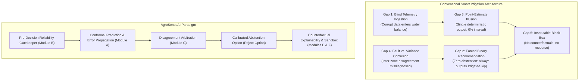

# Critical Research Gaps in Precision Irrigation Systems

**Project:** AgroSenseAI – Confidence-Aware & Explainable Irrigation Intelligence Platform  
**Document:** `docs/RESEARCH_GAP.md`  
**Date:** 2026-10-31  
**Author:** Multidisciplinary Research Team (Senior Full-Stack Engineer, ML Engineer, Agronomy/Hydrology Researcher, Product Designer)  
**Standard Adherence:** Non-Negotiable Integrity Rules #1, #2, #3, #4, #5, #7.

---

## 1. Introduction

Commercial precision agriculture platforms have largely focused on IoT hardware deployment, cloud telemetry ingestion, and slick mobile visualizations. However, from a safety-critical systems perspective, their decision-support pipelines suffer from five structural vulnerabilities. 

This document systematically examines these five research gaps, presenting their mathematical formulations, agronomic consequences, and architectural failure modes.

---

## 2. Gap 1: Blind Sensor Ingestion (Garbage In, Decision Out)

### 2.1. The Technical Vulnerability
Current smart irrigation systems ingest sensor readings from field nodes and immediately compute crop water depletion without a formal pre-decision data validation pipeline. The system implicitly assumes that if a numeric float arrives via MQTT/HTTP with a 200 OK status code, that value accurately represents the physical state of the root zone.

### 2.2. Failure Modes & Agronomic Consequences
1. **Soil Compaction / Air Pocket Artifacts:** Capacitance probes measure the dielectric permittivity of the matrix surrounding the probe. If soil shrinkage (common in vertisols/clays) creates an air pocket ($dielectric \approx 1$), the sensor reports volumetric water content ($\theta$) near zero ($< 5\%$). A blind recommender triggers catastrophic over-irrigation, leading to root asphyxiation, nutrient leaching, and root rot (*Phytophthora*).
2. **Biofouling & Salinity Drift:** Fertilizer application increases electrical conductivity ($EC$). Standard uncompensated FDR (Frequency Domain Reflectometry) sensors interpret elevated ion concentration as increased water content, reporting artificially high moisture. The blind system withholds irrigation during critical crop growth stages, causing permanent yield loss.
3. **Stale Telemetry from Dropped Connections:** If an IoT gateway loses cellular backhaul, systems frequently replay the last known value or fill gaps with simple forward-fill ($x_t = x_{t-1}$). Under 40°C heat and high vapor pressure deficit ($VPD$), a 3-day-old reading of 28% moisture is fatally obsolete.

### 2.3. The AgroSenseAI Paradigm Shift
Before any agronomic or ML calculation executes, data must pass through **Module B (Pre-Decision Reliability Layer)**:
- Physical plausibility gating against known soil texture limits (e.g., Saturation $\theta_s$, Field Capacity $\theta_{fc}$, Permanent Wilting Point $\theta_{pwp}$).
- Spike and step-jump filtering using rolling Median Absolute Deviation ($MAD$).
- Stale weather detection with explicit age thresholding ($> 3$ hours triggers penalty).
- Long-term sensor calibration drift detection heuristics comparing probe trajectories against neighboring sensors and historical evapotranspiration curves.
- Output: A mathematically documented **Data Reliability Score ($DRS \in [0.0, 1.0]$)** with transparent penalty attribution.

---

## 3. Gap 2: Forced Binary Decisions (The Absence of the "Reject Option")

### 3.1. The Technical Vulnerability
Almost all consumer and enterprise agritech applications enforce an exhaustive binary or ternary recommendation:  
$$\text{Decision} \in \{\text{IRRIGATE}, \text{DO\_NOT\_IRRIGATE}\}$$

In commercial software, abstention is viewed as a "poor user experience." Consequently, systems are programmed to always make a definitive call, regardless of whether 80% of sensor inputs are missing or contradictory.

### 3.2. Agronomic Consequences
In agriculture, a false negative (failing to irrigate when required) can permanently scorch crops, while a false positive (irrigating saturated soil) can trigger anaerobic conditions or exhaust limited groundwater allocations. 

Forcing a recommender to guess under extreme data degradation violates the foundational engineering principle of **Fail-Safe Operation**. High epistemic uncertainty (lack of knowledge due to missing or noisy data) should never produce a high-confidence action.

### 3.3. The AgroSenseAI Paradigm Shift
AgroSenseAI formalizes the **Rejection Option (Abstention)**:
$$\text{Output} \in \{\text{IRRIGATE}, \text{NO\_IRRIGATION\_NEEDED}, \text{INSUFFICIENT\_DATA\_VERIFY\_MANUALLY}\}$$

The system triggers `INSUFFICIENT_DATA_VERIFY_MANUALLY` under two deterministic, testable conditions:
1. **Reliability Failure:** $DRS < \tau_{reliability}$ (default threshold $\tau_{reliability} = 0.65$).
2. **Uncertainty Straddle:** The conformal prediction interval for root-zone depletion $[\hat{D}_{r}^{lower}, \hat{D}_{r}^{upper}]$ straddles the Readily Available Water ($RAW$) threshold such that the margin of uncertainty exceeds safe operational tolerance $\Delta_{tol}$.

---

## 4. Gap 3: Point-Forecast Hallucination (The Deterministic Illusion)

### 4.1. The Technical Vulnerability
When irrigation platforms present water depletion, evapotranspiration, or soil moisture forecasts, they display single scalar numbers:
$$\text{"Root depletion is 34.2 mm. Apply 35 mm of water."}$$

This creates a dangerous illusion of precision. In reality, field-scale soil water estimation involves compound uncertainty:
- **Measurement error:** Soil moisture probes have inherent root-mean-square errors ($RMSE \approx \pm 2\text{--}4\%\text{ vol}$).
- **Spatial variability:** Sensor location represents less than $1 \times 10^{-6}$ of the root zone volume in a 5-hectare management zone.
- **Meteorological forecast error:** Numerical weather prediction ($NWP$) models often misestimate incoming solar radiation ($R_s$) by $\pm 15\text{--}25\%$ and precipitation by $> 50\%$.

### 4.2. Mathematical Formalization of Error Propagation
In standard FAO-56 water balance, daily depletion is calculated as:
$$D_{r,i} = D_{r,i-1} - (P_i - RO_i) - I_i - CR_i + ET_{c,i} + DP_i$$

If each parameter $X_k$ carries variance $\sigma_k^2$, assuming independence, the accumulated variance of depletion over time step $t$ compounds:
$$\sigma_{D_r}^2 \approx \sum_{k} \left(\frac{\partial D_r}{\partial X_k}\right)^2 \sigma_{X_k}^2$$

By ignoring this variance, existing platforms risk recommending heavy irrigation immediately before unpredicted precipitation events, causing runoff and fertilizer loss.

### 4.3. The AgroSenseAI Paradigm Shift
AgroSenseAI implements **Dual Uncertainty Quantification (Module A)**:
1. **Monte-Carlo Error Propagation:** Simulates $N = 1,000$ draws from calibrated sensor error distributions $\mathcal{N}(\mu_{sensor}, \sigma_{sensor}^2)$ and forecast weather uncertainties through the full FAO-56 physical equations, generating an empirical probability distribution of soil water depletion.
2. **Split Conformal Prediction on Quantile Gradient Boosting:** Trains gradient boosting regressors on hydrologic features to predict quantiles ($\alpha/2, 1 - \alpha/2$) and uses held-out calibration sets to construct guaranteed coverage intervals:
   $$P\left(D_r \in \left[\hat{q}_{\alpha/2}(x) - \hat{s}_{1-\alpha}, \hat{q}_{1-\alpha/2}(x) + \hat{s}_{1-\alpha}\right]\right) \ge 1 - \alpha$$
The UI displays the median along with the 90% prediction interval and the Expected Calibration Error ($ECE$).

---

## 5. Gap 4: Misdiagnosing Agronomic Variability as Sensor Faults (and Vice Versa)

### 5.1. The Technical Vulnerability
When two sensors in adjacent zones report divergent readings (e.g., Zone 1 reports $\theta = 32\%$, Zone 2 reports $\theta = 19\%$), existing algorithms either:
- Average them out (canceling out critical local conditions), or
- Naively flag the outlier as a "hardware malfunction" using a basic threshold test.

### 5.2. Agronomic Reality: The Multi-Factor Landscape
Soil moisture differences between zones are often **completely genuine** due to:
- **Soil Textural Changes:** A transition from clay loam (high field capacity) to sandy loam (low field capacity) across the same property.
- **Topography & Infiltration:** Zones situated in slight depressions receive localized surface runoff from heavy rains, while ridge zones drain rapidly.
- **Crop Canopy Architecture:** Varying planting dates, cultivars, or pruning regimes create distinct evapotranspiration sinks.

Discarding real soil variability as a sensor defect blinds the farmer to critical localized drought stress. Conversely, treating an unseated sensor as true soil variability leads to improper irrigation applications.

### 5.3. The AgroSenseAI Paradigm Shift
AgroSenseAI introduces **Sensor Disagreement Arbitration (Module C)**:
Instead of assuming divergence equals hardware failure, Module C cross-references inter-zone variance against auxiliary physical evidence:
- **Soil Texture Normalization:** Normalizes raw volumetric content $\theta$ to percent of available water capacity ($\%AWC = \frac{\theta - \theta_{pwp}}{\theta_{fc} - \theta_{pwp}} \times 100$).
- **Precipitation Response Correlation:** Examines if both sensors exhibited consistent upward inflection timing during recent rain events.
- **Dynamic Classification:** Categorizes the divergence into one of three explicit states:
  1. `likely_real_variability` (plausible based on soil texture, topography, and rain response),
  2. `possible_sensor_fault` (implausible step change, lack of rain response, high rolling MAD),
  3. `inconclusive` (insufficient multi-zone history).

---

## 6. Gap 5: Inscrutable Black-Box Recommenders & Lack of Farmer Agency

### 6.1. The Technical Vulnerability
Most recent "AI-powered" agritech tools deploy black-box deep learning or gradient-boosted models that output high-level prescriptions with opaque justifications such as:
> *"Our AI recommends 4.5 hours of drip irrigation based on proprietary microclimate modeling."*

When farmers cannot understand the agronomic rationale behind an automated suggestion, two failure modes occur:
1. **Automation Distrust (Algorithmic Aversion):** Experienced growers reject the platform entirely and revert to visual inspection or fixed-timer irrigation.
2. **Automation Complacency:** Inexperienced operators blindly obey the system until a catastrophic overwatering event destroys a yield.

Furthermore, traditional Explainable AI (XAI) outputs (such as feature importance heatmaps or raw SHAP values) are incomprehensible to non-data-scientist farmers. A farmer does not care that "feature_12 has a SHAP value of +0.31"; they need to know what physical agronomic threshold drove the decision.

### 6.2. The AgroSenseAI Paradigm Shift
AgroSenseAI delivers **Farmer-Centric Actionable XAI (Modules E & F)**:
1. **Hydrologic Driver Decomposition:** Explicitly ranks and presents the real-world physical drivers behind every decision:
   - Current Root Depletion vs. Readily Available Water ($D_r \text{ vs. } RAW$),
   - Forecast Atmospheric Demand ($ET_c = K_c \cdot ET_0$),
   - Anticipated Infiltration ($P_{eff}$).
2. **Counterfactual Recourse Engine:** Computes the exact physical tipping points:
   > *"Current Decision: NO_IRRIGATION_NEEDED.*  
   > *What would change this recommendation?*  
   > *• If soil moisture drops below 21.2% (currently 24.8%).*  
   > *• OR if tomorrow's rainfall drops below 1.5 mm (currently 12.0 mm)."*
3. **Interactive What-If Simulation Sandbox (Module F):** Enables farmers to safely stress-test decisions before opening valves:
   - "What if the forecast rain does not arrive?"
   - "What if tomorrow's temperature exceeds 38°C?"
   - "What if Sensor 2 drops offline?"
   Every simulated run is distinctly badged as `SIMULATED` to maintain complete data provenance.
4. **Bilingual Accessibility:** Native, accessible phrasing in Hindi and English with clean visual badges (combining color, clear iconography, and explicit text so accessibility is never compromised).

---

## 7. Summary of Research Gaps and AgroSenseAI Solutions

| Research Gap | Conventional Flaw | AgroSenseAI Architectural Solution | Primary Governing Module |
| :--- | :--- | :--- | :--- |
| **1. Blind Ingestion** | Corrupted or drifted sensor signals flow unchecked into recommendations. | Multi-tier pre-decision reliability validation and explicit penalty score ($DRS$). | **Module B** |
| **2. Forced Binary Choice** | Recommender forces a decision even under total data breakdown. | Calibrated **Abstention Protocol** (`INSUFFICIENT_DATA_VERIFY_MANUALLY`). | **Module A & Decision Core** |
| **3. Point-Estimate Illusion** | False precision of single scalar predictions without error margins. | Monte-Carlo propagation + Conformal Prediction intervals with coverage guarantees. | **Module A & Module G** |
| **4. Fault vs. Variance Confusion** | Sensor disagreement naively averaged or falsely flagged as equipment failure. | Robust MAD and inter-zone soil-texture normalized disagreement arbitration. | **Module C** |
| **5. Inscrutable Black-Box** | Opaque AI prescriptions lacking agronomic justification or farmer recourse. | Transparent FAO-56 balance, counterfactual threshold explanations, and What-If sandbox. | **Module E & Module F** |

